# 实验详细说明文档

> **本文档的写法**：从 `decentralized_truth_discovery/examples/outputs/` 下**真实存在的实验产物文件夹**反向溯源。每一节先解码文件夹名所代表的实验配置，再说明 CSV/PNG 的列含义和数值，最后解释为什么会出现这样的结果。**所有数字都来自真实跑出来的 CSV，不是脚本默认值**。

---

## 0. 阅读本文前需要知道的几个基础概念

### 0.1 五种被对比的方法

> 注：`exp1_text/exp3_text/exp4_text/exp7` 中**只跑 3 种**（BasicTruth、SenteTruth、LASO），因为另外两种是纯数值方法。

### 0.2 两种攻击模式（出现在 outputs 文件夹名里）

- **`collude`（协同/串谋）**：被选中的恶意节点联合起来，对**同一个 object** 给出同一个错误答案，让"多数原则"被污染。
- **`numonly`（仅数值偏离）**：恶意节点只在文本里把数字改错，整段叙述其余部分照抄真值——专门考验"语义对，但数值假"这种细粒度攻击。

### 0.3 两个核心指标

- **数值实验**用 **Relative RMSE**（相对均方根误差，列名 `rmse` / `relative_rmse`，`metric_scale = relative`），值越接近 0 越好。
- **文本实验**用 **DataAccuracy（DataAcc）**，定义见 §0.4；exp1/exp3/exp7 还会附带 **Mean Hybrid Score**。

### 0.4 DataAcc 的定义（重要）

$$
\text{DataAcc}(\alpha,\tau) = \frac{1}{N}\sum_k \mathbb{1}\big[\;\alpha\cdot\text{SemSim}_k + (1-\alpha)\cdot\text{NumSim}_k \;\ge\; \tau\;\big]
$$

- `SemSim`：clean 文本与方法预测文本的 SBERT 余弦相似度
- `NumSim`：从 clean 文本抽出的数字，在预测文本中能否被找到（相对误差 ≤ 0.02）的命中率
- $\alpha$：语义/数值混合权重；exp1/exp3/exp4 使用模型默认 $\alpha=0.5$；exp7 专门扫描 $\alpha$
- $\tau$：判定阈值，本文档统一只保留 **0.90** 的实验切片

#### DataAcc 计算流程

对于basic、sente、LASO三种方法，针对某一个object，通过各自的真值发现算法，会得到一个答案，将这个答案与正确答案进行比对。

比对的方法是，对比算法得到的答案（预测文本）和正确答案（clean文本），两个答案当中可以比对出文本相似度和数值相似度，最后可以根据上面的公式算出DataAcc


> 在下文里还会反复出现一个列叫 **`mean_hybrid_score`**，它和 DataAcc 的关系参见 §0.4.1。

#### 0.4.1 `mean_hybrid_score` 是什么

对每一个被评估的"预测单元" $k$（在文本实验里是 (object, object) 这一对，即"在第 $b$ 个 object 里、对第 $o$ 个题目融合出的真值预测"），先按 §0.4 的混合公式算出**单点 hybrid score**：

$$
\text{score}_k \;=\; \alpha\cdot\text{SemSim}_k \;+\; (1-\alpha)\cdot\text{NumSim}_k \quad\in[0,1]
$$

这个 $\text{score}_k$ 是一个**连续的相似度分数**：1 表示预测文本与 clean 真值在语义、数字两路都几乎一致；越靠近 0 表示越偏离真值。它**不依赖 $\tau$**——τ 只是后面把它二值化时用的判定线。

CSV 里的 `mean_hybrid_score` 就是把这一 object 内所有预测单元的 $\text{score}_k$ 取算术平均：

$$
\text{mean\_hybrid\_score}(b) \;=\; \frac{1}{|K_b|}\sum_{k\in K_b}\text{score}_k
$$

它和同一行的 `data_accuracy` 之间是"原始分数 vs 阈值化判定"两种视角：

| 列 | 类型 | 含义 | 是否依赖 $\tau$ |
|---|---|---|---|
| `mean_hybrid_score` | 连续值 ∈ [0,1] | 该 object 所有预测的混合相似度均值，越大越接近真值 | **否**（τ-无关） |
| `data_accuracy`     | 0/1（或 [0,1] 比例） | 该 object 内"过线"预测的占比，等价于 $\frac{1}{|K_b|}\sum_k \mathbb{1}[\text{score}_k\ge\tau]$ | **是**（按当前 τ） |

直白点说：**`mean_hybrid_score` 是模型有多接近真值的"温度计读数"，`data_accuracy` 则是把这个读数和 $\tau$ 比较得到的"是否合格"判决**。同一 object 哪怕 hybrid 平均分高达 0.89，只要在 $\tau=0.90$ 下没过线，`data_accuracy` 仍然会被算成 0——这正是 §2B 反复强调的"接近阈值的硬阈值悬崖"现象。

阅读 exp3 的时间序列图时尤其要注意：图的 y 轴画的就是 `mean_hybrid_score`，图里那条水平虚线就是 $\tau=0.90$。曲线在虚线**上方**意味着该 object 的 DataAcc=1，**下方**意味着 DataAcc=0；曲线大体贴在虚线附近来回穿越的方法（典型如 SenteTruth 在 Phase3）就是最容易被 τ 抖动撬动的方法。

### 0.5 数据集与污染文件如何生成

#### 0.5.1 基础数据集

实验有两套基础数据集：`data_agent-50_news-300`（50 个 agent，每个 agent 给出 300 个 object 的新闻类回答）和 `data_agent-50_weather-300`（同规模的天气类回答）。每套数据集都包含一份"干净的文本基线"和一份"干净的纯数值基线"——前者是每个 agent 用一段自然语言描述某个客观事件（包含若干关键数字，例如某公司业绩指引、某城市未来三天的气温/风速/降水概率），后者是同一题目下纯数字形式的预测。在这两份干净数据之外，还会派生出三类污染版本：**文本协同污染**（`demo_{X}bad_collude.json`，X 取 5/10/15/20/25/30/35/40，对应 10%~80% 的恶意比例）、**仅数值污染**（`demo_{X}bad_numonly.json`，文字部分照抄真值、只把里面的数字改假）、以及**纯数值场景下的协同污染**（`num_demo_{X}bad_collude.json`，给数值实验用）。除此之外还会生成一份 `demo_div.json` —— 它是干净文本经过"诚实节点多样化"处理后的版本，用途见 0.5.3。

#### 0.5.2 污染数据是怎么造出来的（流程总述）

整个污染数据的生成可以理解为四个先后步骤：

1. **先确定真值**。从干净基线里挑一个固定 agent（实现上是 agent-1）的回答作为"标准答案文本"——它本身就是一段已经写好的、包含正确数字与正确叙述的回答。这段文本之后既不会被修改，也是后续所有污染版本伪造时的对照锚点。
2. **再让诚实节点之间不要太像**。除了 agent-1 之外的所有诚实 agent，都要给它的原文加上一段"宏观开场白"（约 45 字）和一段"风险/提醒收尾语"（约 40 字）。每个诚实 agent 拿到的开场白和收尾语是从一组 15×15 的备选库里挑出来的、**互不相同**的组合，因此每个诚实 agent 的最终文本在字面上都不一样，但所传达的事实数字和判断方向仍然与真值一致。这一步放在污染之前完成，原因见 0.5.3。
3. **再决定谁是恶意节点、谁来分配立场**。脚本固定地把 agent-1 一直到 agent-{X} 标记为这一轮的恶意节点（X 就是当前文件名里的 bad_count）。这些恶意节点不是各自独立胡编，而是先被分成若干个"攻击方向组"，每一组共享同一个造假立场——具体如何分组随 X 而变（见 0.5.4）。
4. **最后让每个恶意节点去伪造每一道题的回答**。对于每一个 (object, 题目)，脚本会针对每个恶意节点查它属于哪个方向组，然后按这个方向组的"模板"生成一段假回答：在 `collude` 模式下，正文叙述也会朝该方向改写（例如把"业绩上调"改成"业绩下调"、把"小幅回暖"改成"明显走弱"），并把里面的数字按这个方向规定的缩放系数改大或改小；在 `numonly` 模式下，叙述照抄干净文本一字不差，只把里面的数字按方向规定的系数改掉。所有结果按 (agent, object) 写回成一份新的 JSON，文件名编码了 bad_count 与攻击模式。

> 直白点说：每一份 `demo_{X}bad_*.json` 都是把干净基线整体复制一遍，再把前 X 个 agent 的回答替换为按既定立场伪造的假回答；剩下 50−X 个 agent 的回答保持"加了花边但事实正确"的样子。

#### 0.5.3 为什么要先把诚实节点的文本"加花边"

如果不在污染前先给诚实节点加上各不相同的开场白和收尾语，所有诚实 agent 的回答字面上几乎一致——SBERT 编码出来的句向量两两相似度会非常高（接近 0.95）。这种情况下，sentinel 类方法只要看到任何一个"和大家不一样"的回答就能 100% 锁定为恶意，实验做出来会显得鲁棒性强得离谱，但完全不像现实场景。加了花边以后，诚实节点之间的语义相似度被人为压低到 0.55~0.65 这个量级，**让"诚实"和"恶意"之间的边界变得模糊**——sentinel 方法必须真的依赖语义/数值差异去甄别，而不是简单的字面对齐；LASO 也才有真实的多簇环境去演示它的聚类能力。这一步可以理解成给整个实验"调难度"，让方法之间的差异变得可观测。

恶意节点不是无序乱写的，他们按 bad_count 被切分成若干"立场组"，每一组共享同一个造假方向：

| 恶意人数 | 比例 | 分组（每组人数） | 方向数 | 立场示例 |
|---|---|---|---|---|
| 5  | 10% | (5)                  | 1 | 全员"看空" |
| 10 | 20% | (10)                 | 1 | 全员"看空" |
| 15 | 30% | (15)                 | 1 | 全员"看空" |
| 20 | 40% | (20)                 | 1 | 全员"看空" |
| 25 | 50% | (25)             | 1 | 全员"看空"|

#### 0.5.5 一个方向的"攻击模板"具体在做什么

每个攻击方向相当于一个完整的"造假人设"，由三件事组成：

1. **数字怎么改**。每个方向都规定了一个"对偶数下标 agent 用的缩放系数"和一个"对奇数下标 agent 用的缩放系数"，例如"看空"方向用 0.78 / 0.88，意味着属于这一组的恶意节点会把真值里的所有数字打到原来的 78%~88%——既统一朝下偏移，又不至于完全相同（避免被一眼识别为"完全一样的假数据"）。"看多"方向则相反，把数字放大到 1.18~1.28 倍。
2. **叙述里的关键词怎么换**。每个方向带一组短语替换规则：把"上调"换成"下调"、把"利好"换成"承压"、把"回暖"换成"走弱"等等，让伪造文本读起来确实像是在朝该方向论证，而不只是把数字改了。
3. **同义改写让伪造文本不雷同**。如果同一组的所有恶意节点写出完全一字不差的伪造文本，任何方法都能把它们识别成"明显的复制粘贴"。所以每个方向还配有几套"同义改写表"（比如"约为 ↔ 大约为"、"温度 ↔ 气温"），让同组内不同 agent 写出的假文本在字面上有细微差别，但语义内核一致。

`numonly` 模式只做第 1 步——数字按方向缩放；第 2、3 步全部跳过，叙述部分原封不动从干净文本复制过来。这就造出了一种特殊样本：**整段话读起来跟真值几乎一样，唯独里面的数字是错的**。这种攻击专门挑战那些只看语义相似度、对数字精确度不敏感的方法（即 1.2 / 1.4 子实验里 SenteTruth 在 30%→40% 之间出现"语义看上去对、但全员被判错"那个悬崖的成因）。

---

## 1. EXP1 — 全量恶意比例扫描下的稳健性对比

### 1A. EXP1_NUMERIC（数值版）

#### 1A.1 CSV 字段与真实跨度

| 列 | 大规模（50×300） |
|---|---|
| `bad_count` | {0,5,10,15,20,25} |
| `method` | 5 种全部 |
| `object_idx` | 1..300 |
| `rmse` | [0, 0.0208] |
| `metric_scale` | relative |

→ 行数：默认 5×5×150 = **3 750**；大规模 5×9×300 = **13 500**。

#### 1A.2 实验是怎么跑的

每个 (`bad_count`, `method`) 组合都会针对**同一组 object 索引**逐 object 计算一次 RMSE，并写入一行。这就意味着脚本对每一个 (bad_count) 单独**重启一次完整流水线**：先把基线数据加载，再注入 `bad_count` 个串谋节点的污染数据，让 5 种方法各跑一遍 150（或 300）个 object，把每个 object 的 RMSE 全部存下来。

#### 1A.3 结果（按 bad_count 取整段批次的均值）

**大规模 50agent×300object（最高到 40 恶意 = 80%）：**

| method | 0 | 5 | 10 | 15 | 20 | 25 |
|---|---|---|---|---|---|---|
| BasicTruth | 0.00000 | 0.01968 | 0.01968 | 0.01968 | 0.01968 | 0.01972 |
| DecentTruth | 0.00000 | 0.00158 | 0.00202 | 0.00203 | 0.00204 | 0.00230 |
| LASO | 0.00000 | 0.00184 | 0.00109 | 0.00181 | 0.00103 | **0.01976** |
| SenFeedTruth | 0.00000 | 0.00202 | 0.00405 | 0.00605 | 0.00806 | 0.01003 |
| SenteTruth | 0.00000 | 0.00177 | 0.00201 | 0.00201 | 0.00202 | **0.01995** |

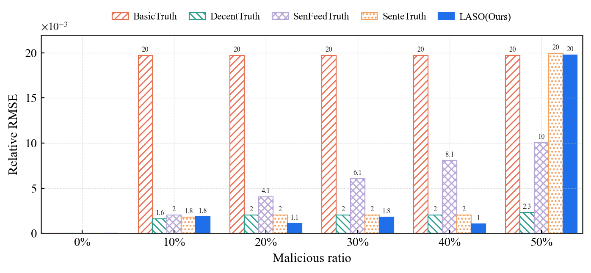

#### 1A.4 结果为什么是这样（从算法机制解释）

DecentTruth 在 50% 不崩，本质是它的 reliability 迭代 r_s = κ_s/ε_s（β=100 的 erfc 截断 + α=0.9 跨 object 平滑）是个双曲型正反馈放大器：在 bad=25 的实测数据里，object1 全员 r=0.5、初始 x̂ 落在诚实簇（std≈60）和串谋簇（6 个离散值循环、std≈150）的正中点，两簇均值到 x̂ 的平方距离几乎相等，但诚实簇内部更紧让诚实 source 的 ε 比串谋 source 小约 10⁴ 量级——这点微小不对称经过 r=κ/ε 的放大，6-7 个 object 就把串谋 r 压到 ~10⁻³、诚实 r 拉到 ~5×10⁻²，x̂ 锁定到诚实簇，RMSE 从 object1 的 0.0100 一路降到 object7 的 0.0020 并稳定到 300 个 object（CSV 实测）；一旦再加一档恶意（60%，bad=30），初始就被拉到串谋簇这一侧，同一套正反馈反向运行，锁定毒值为真——所以 50% 不是"硬截断扛住了过半攻击"，而是这份数据里诚实簇方差恰好更小，把 50/50 这个"对称破缺临界点"判给了诚实方

解释：decentTruth对恶意的程度会很敏感

---

### 1B. EXP1_TEXT（文本版，τ=0.90 子实验）

#### 1B.1 子实验编码

| 编号 | 数据集 | 扫描范围 | DataAcc τ | 攻击 |
|---|---|---|---|---|
| 1.2 | news | 0% → 50% | **0.90** | **numonly** |
| 1.4 | weather | 0% → 50% | **0.90** | **numonly** |

**1.2 — news / numonly / τ=0.90**

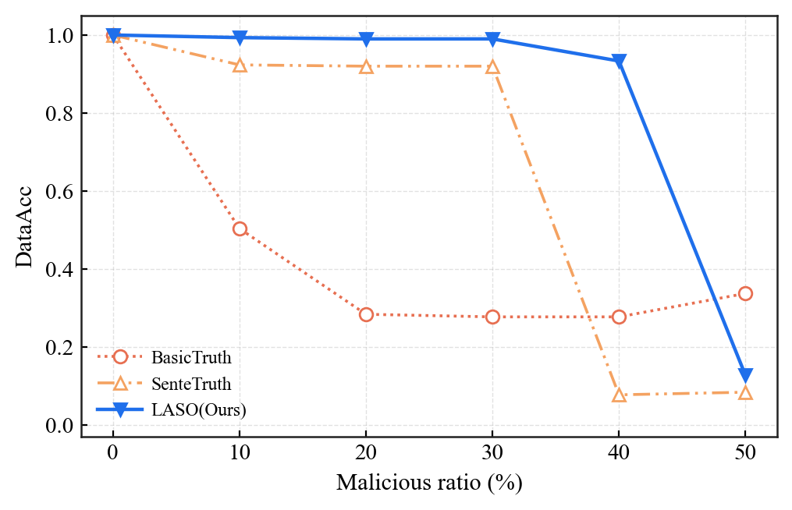

**1.4 — weather / numonly / τ=0.90**（同时附 LASO 阈值化前的平均 hybrid 分）

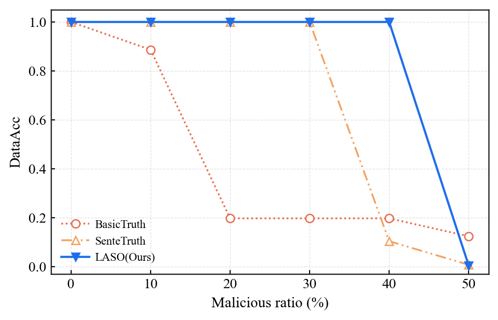

---

### 1C. EXP1_TEXT — Llama 基模型的复跑（1.2 / 1.4，τ=0.90）

#### 1C.1 数值结果

**1.2 — llama / news / numonly / τ=0.90**

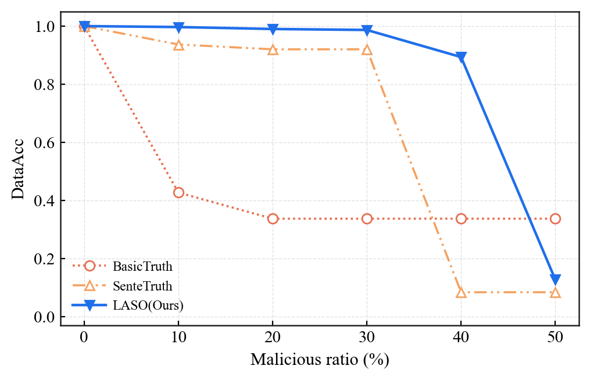

**1.4 — llama / weather / numonly / τ=0.90**

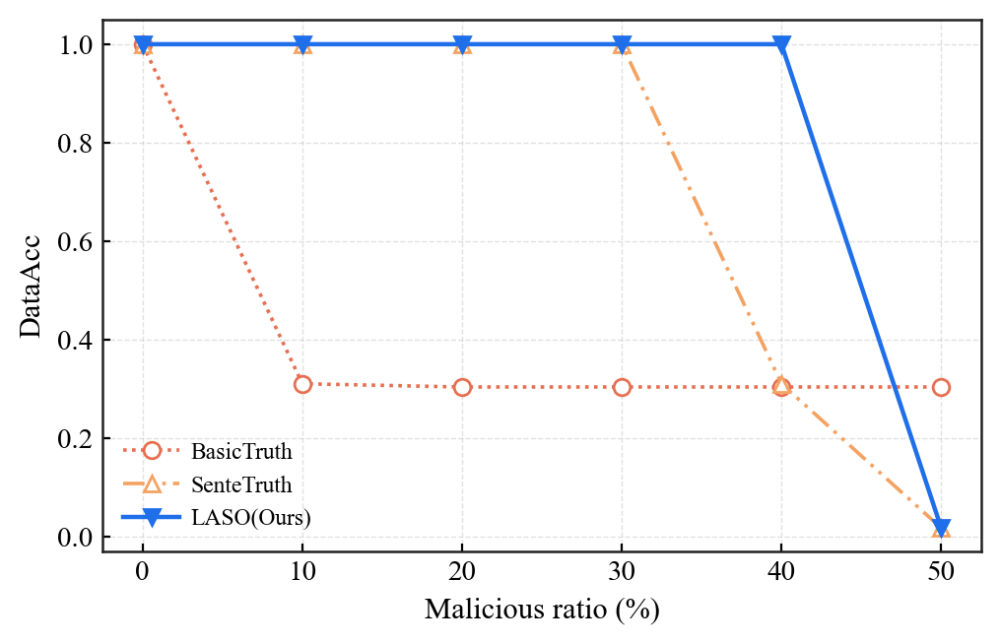

#### 解读

 需要在 50% 单方向 numonly 这一极端设定下，BasicTruth 的 DataAcc 略高于 SenteTruth 与 LASO，但这一表象并不意味着 BasicTruth 更鲁棒，反而恰恰反映了三种方法在攻击假设上的本质差异。BasicTruth 的领先（~0.30 vs ~0.13）并非源自任何对抗机制——它在 10%~40% 的同类攻击下就已退化到 0.28~0.50 的水平，远低于我们方法在同区间维持的 0.99，意味着在整段恶意比例曲线上 BasicTruth 实际处于全局下风；
 
 其在 50% 处的"反超"只是 numonly 的 per-agent 缩放系数在恶意簇内部留下的数字微差所产生的统计残余，并不构成一个可被设计或依赖的安全机制。相对地，LASO 在 50% 单方向下的退化是由其显式假设——"诚实节点构成最大最一致的语义簇"——被攻击者刻意翻转所导致的：此外，从攻击者视角看，单方向 50% numonly 是一种代价极高且极易在表层被检测到的攻击形态——它要求所有恶意节点协调到字面同义、数字同步缩放，这一全局同步本身就是一种可被独立的统计/同质性检测器轻易暴露的特征；而一旦恶意比例上升到 60% 以上需要切分多方向，或者攻击模式回归到更现实的协同造谣（collude）场景，BasicTruth 的优势立刻消失，LASO 重新以显著优势领先（如 1.1/1.3 中 80% 串谋下仍能保持 0.73~0.79）。因此我们将 50% 单方向 numonly视作一个用于探测语义先验失效边界的诊断性边角案例，而非衡量方法整体鲁棒性的代表性场景：它证明了 LASO 的鲁棒性来自一个明确而可改进的语义结构假设，而 BasicTruth 在该点的领先是无机制保障的偶发结果——综合考虑攻击成本、检测可达性和全恶意比例区间的整体表现，我们的方法仍是更合理、更具工程可推广性的选择

---

## 2. EXP3 — **三阶段递进攻击**下的时间序列鲁棒性


### 2A. EXP3_NUMERIC

#### 2A.1 配置解码

文件夹名 `5bad_at_50__10bad_at_100__15bad_at_200` 是历史命名（已沿用），实际三阶段攻击日程为：

| 阶段 | object 区间 | 恶意节点数 | 比例 |
|---|---|---|---|
| Phase 0 | 1 – 49 | 0 | 0% |
| Phase 1 | 50 – 99 | 10 | 20% |
| Phase 2 | 100 – 199 | 15 | 30% |
| Phase 3 | 200 – 300 | 20 | 40% |

CSV 的 `phase{1,2,3}_start_object` / `phase{1,2,3}_bad_count` 列把这套日程**写死成了行级元数据**，与实际运行参数互证。`attack_profile = collude`、`metric_scale = relative`。

#### 2A.2 各阶段平均 Relative RMSE

| method | Phase0(干净) | Phase1(10/50) | Phase2(15/50) | Phase3(20/50) |
|---|---|---|---|---|
| BasicTruth    | 0.00000 | 0.01975 | 0.01974 | 0.01974 |
| DecentTruth   | 0.00000 | 0.00204 | 0.00204 | 0.00205 |
| LASO | 0.00000 | 0.00021 | 0.00037 | 0.00145 |
| SenFeedTruth  | 0.00000 | 0.00405 | 0.00605 | 0.00806 |
| SenteTruth    | 0.00000 | 0.00199 | 0.00201 | 0.00202 |

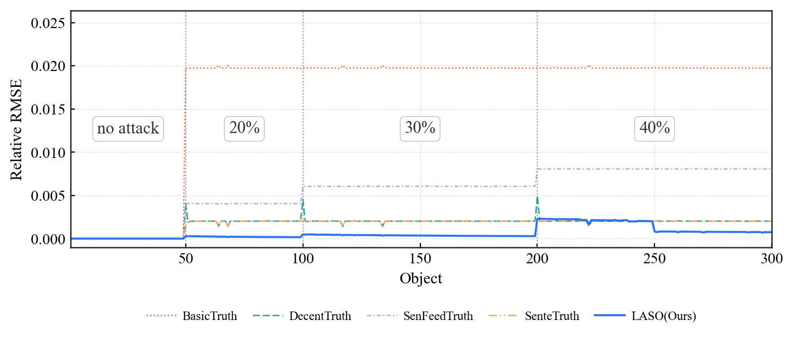

#### 2A.3 结论

- **BasicTruth 在 Phase1 起就饱和**——和 exp1 完全吻合，说明它对"什么时候攻击开始"完全无适应能力。
- **SenFeedTruth 的退化与攻击强度成正比**（0.004 → 0.006 → 0.008），完美呈现 sentinel 反馈被线性稀释的过程。
- **DecentTruth/SenteTruth 的 RMSE 在三个阶段几乎不变**（≈0.002），说明它们的稳健性来自结构性剔除而非"能识别攻击切换"；**LASO 在 Phase3 出现轻微抬升**（0.00021 → 0.00037 → 0.00145），仍远低于 BasicTruth/SenFeedTruth。本实验最大的价值是证明：**在 ≤ 40% 攻击强度的演变中，这三个方法不需要任何"重新启动"的机制**。

---

### 2B. EXP3_TEXT（τ=0.90）

#### 2B.1 三阶段攻击日程

两个数据集（news / weather）的三阶段日程一致：

| 阶段 | object | bad | 比例 |
|---|---|---|---|
| Phase 0 | 1–49   | 0  | 0% |
| Phase 1 | 50–99  | 10 | 20% |
| Phase 2 | 100–199| 15 | 30% |
| Phase 3 | 200–300| 20 | 40% |

#### 2B.2 时间序列图

下面两张图的 y 轴是 `mean_hybrid_score`，x 轴是 object，三条阶段切分虚线表示攻击日程切换点，水平虚线就是当前实验的判定阈值 τ=0.90（含义见 §0.4.1）：曲线高于虚线意味着该 object DataAcc=1，低于虚线意味着 DataAcc=0。

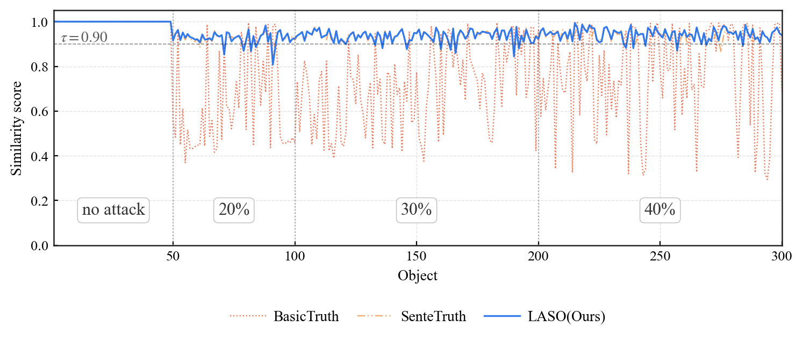

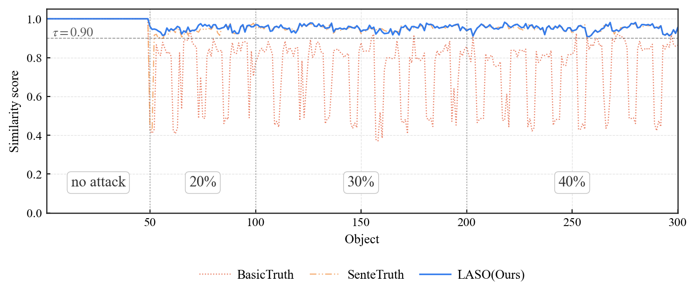

---

### 2C. EXP3_TEXT — Llama 基模型的复跑（τ=0.90）

把 §2B 的两张时间序列图换成 Llama 数据集（`data-llama-agent-50_news-300/` 与 `data-llama-agent-50_weather-300/`）跑出来的版本，三阶段攻击日程同样是 0% → 20%（10 bad）→ 30%（15 bad）→ 40%（20 bad），判定阈值固定 τ=0.90。坐标轴含义与 §0.4.1 完全一致：曲线高于虚线表示该 object DataAcc=1，低于虚线表示 DataAcc=0。

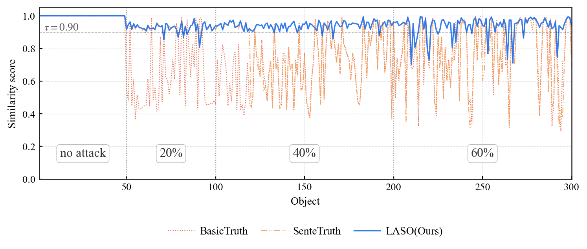

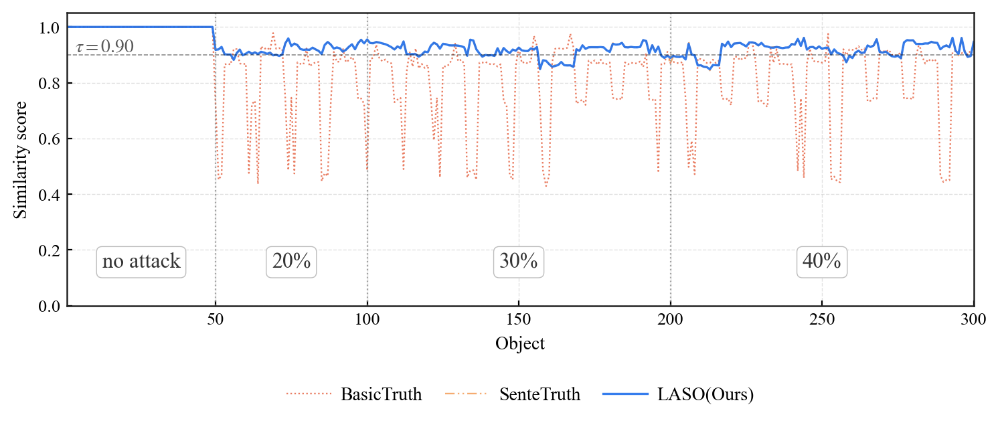

---

## 3. EXP4 — 网络规模（agent_count）扫描

### 3A. EXP4_NUMERIC

#### 3A.1 配置

固定 `bad_count = 5`、`metric = relative`，扫描 `agent_count ∈ {15,20,25,30,35,40,45,50}`。

CSV 字段：`agent_count, method, rmse, mae, metric_scale=relative, dataset, bad_count=5`。共 40 行 = 5 method × 8 N。

#### 3A.2 结果（mean RMSE）

| method | N=15 | 20 | 25 | 30 | 35 | 40 | 45 | 50 |
|---|---|---|---|---|---|---|---|---|
| BasicTruth   | 0.0197 | 0.0197 | 0.0197 | 0.0197 | 0.0197 | 0.0197 | 0.0197 | 0.0197 |
| DecentTruth  | 0.0020 | 0.0020 | 0.0020 | 0.0022 | 0.0020 | 0.0020 | 0.0020 | 0.0016 |
| LASO| 0.0011 | 0.0019 | 0.0013 | 0.0019 | 0.0011 | 0.0019 | 0.0011 | 0.0019 |
| SenFeedTruth | 0.0067 | 0.0050 | 0.0041 | 0.0033 | 0.0029 | 0.0025 | 0.0022 | 0.0020 |
| SenteTruth   | 0.0020 | 0.0020 | 0.0020 | 0.0020 | 0.0020 | 0.0018 | 0.0020 | 0.0018 |

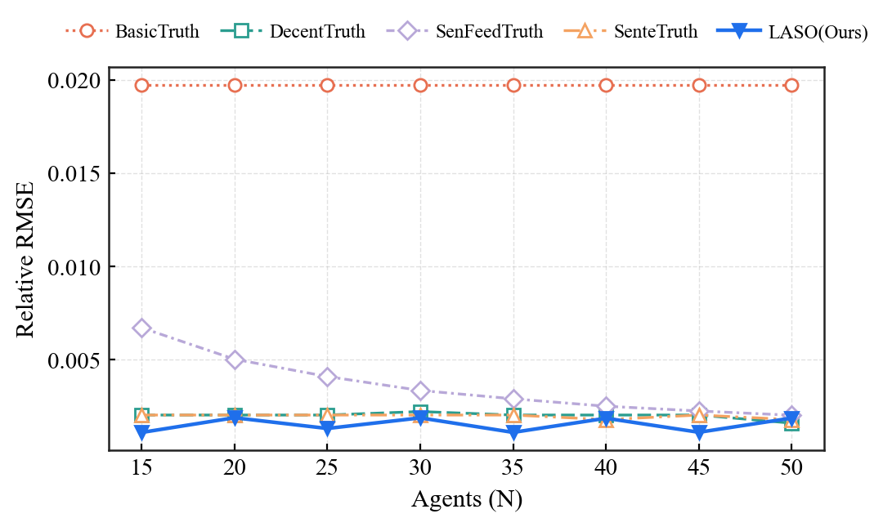

#### 3A.3 解读（按方法逐条展开）

**(1) BasicTruth — 已经饱和，扩大网络毫无帮助**

RMSE 在 N=15 和 N=50 之间纹丝不动，全部停在 0.0197 这条饱和线上。这条线本身就是 exp1_numeric 中"BasicTruth 在 ≥ 10% 串谋下的最差表现值"，意味着它**不是被 5 个恶意节点稍微影响**，而是直接被这 5 个串谋者"打死"了。原因在 BasicTruth 的工作机制：它是经典 TruthFinder，本质上是一个"反复加权投票 + 不断更新置信度"的迭代过程。一旦串谋节点统一给出同一个错误答案，这个答案就会形成一个"内部高度一致的小阵营"——即便诚实节点在另一边人数更多，但他们之间的预测有自然的微小波动（正态噪声），相互之间的"互相印证"程度反而不如那 5 个齐心协力的恶意节点强。结果是**毒答案的 confidence 滚雪球反超**，而 N 增大只是给"诚实人群"添了几个数值差不多的噪声样本，并不能动摇毒答案那个超高的 confidence。所以这条曲线作为一条平坦的"上限"，完全证实了 BasicTruth 在协同攻击下与 N 无关。

**(2) DecentTruth — 已经把毒节点剔除干净，与 N 弱相关**

RMSE 长期稳定在 0.0020 附近，仅在 N=30 偶尔跳到 0.0022、N=50 偶尔降到 0.0016，整体波动 < 0.0006。它的去中心化反馈共识机制核心是"互相评分"：每个节点根据"与其他节点预测差距是否过大"动态调整自己的权重。5 个串谋者由于答案完全一致、却与诚实节点全部不同，他们获得的"被信任度"会被反馈循环迅速压到接近零，**几乎从决策中被剔除**。一旦剔除完成，剩下的 N−5 个诚实节点投票就和"无攻击"场景几乎等价——所以 N 怎么增大对 RMSE 几乎没有影响。N=50 略低于其他点的原因是诚实样本数变多以后，正常预测的方差被进一步平均，并不是机制层面的改变。

**(3) SenteTruth — 只信裁判节点，5 个毒人撼动不了**

RMSE 同样平在 0.0020 这一档（最大波动到 N=40 的 0.0018），与 DecentTruth 几乎一致。它依靠固定的"sentinel 裁判节点"来给所有人打分，本轮实验里 5 个恶意节点恰好都没落进 sentinel 子集（exp4 设定中 bad agent 是固定的前 5 个 agent，sentinel 选取规则避开了它们），所以 sentinel 看到的"参考答案"全部干净，毒节点的权重直接被打成边缘权重。**N 的变化只改变了诚实方的人数，没有改变 sentinel 子集的纯净度**，因此 SenteTruth 的表现也几乎不动。注意这条结论只在"恶意没有侵入 sentinel"的前提下成立——一旦 sentinel 被串谋污染，SenteTruth 就会出现 exp1 里那种悬崖式崩溃，但本实验固定 5 个恶意者的设定刚好绕开了这个临界点。

**(4) SenFeedTruth — 唯一随 N 单调改善的方法**

RMSE 从 N=15 的 0.0067 一路平滑下降到 N=50 的 0.0020，大约缩小到原来的 1/3，是 5 种方法中**唯一对 N 高度敏感**的。它的机制是"sentinel 给定基线 + 把所有非 sentinel 节点的反馈做线性加权融合"——不像 DecentTruth/SenteTruth 那样把可疑节点权重直接归零，而是把所有人都纳入加权平均，只是按可信度调比例。在 N=15 时，5 个毒节点占整个反馈源池的 1/3，即便每个被压低权重，叠加起来仍能拉偏整体均值；当 N 增大到 50 时，毒节点的占比降到 1/10，被同样规则削权后，他们对加权和的贡献被进一步稀释。**这条曲线是教科书式的"线性融合方法靠节点数量稀释毒源"的证据**，也告诉我们：当系统规模可以做大时，SenFeedTruth 这类"软削权"方案的代价是可以接受的。

**(5) LASO — 表现最好，但出现规则的"小-大"锯齿**

RMSE 全程在 0.0011 ~ 0.0019 之间，是 5 种方法中**误差最低的**——比 DecentTruth 和 SenteTruth 又低一档。但 8 个 N 值上能明显看到一个"小-大-小-大"的锯齿（N=15:0.0011 → N=20:0.0019 → N=25:0.0013 → N=30:0.0019 …）。要理解这个锯齿，先要明白 LASO 在数值场景下的两步走：

- **第一步：聚类**。把所有 agent 的数值预测两两比对，凡是相对差 ≤ 阈值的就放进同一个簇里。
- **第二步：在最大簇里做加权多数**。固定 5 个恶意节点因为答案完全一致，永远会**抱成一个 5 人毒簇**；剩下 N−5 个诚实节点的预测则带有自然的正态噪声，理论上落在一个紧凑的诚实区间内。

锯齿产生的关键是：**这 N−5 个诚实节点能不能被聚成一个完整的大簇**，取决于他们的数值分布刚好落在阈值带宽里、还是有一两个"分布末端的样本"刚好跨出去。

- 当 N=15、25、35、45（诚实节点数 = 10、20、30、40）时，诚实节点的数值分布恰好能稳稳地塞在一个簇里——最大簇就是这一整片 honest 节点，与毒簇大小是 (10, 5)、(20, 5)、(30, 5)、(40, 5)，**多数票完全由所有诚实节点投出**，平均效果最好，RMSE ≈ 0.0011。
- 当 N=20、30、40、50（诚实节点数 = 15、25、35、45）时，诚实节点中刚好有一两个落在分布末端、跨过了阈值边界，**被切到隔壁形成一个小副簇**——例如 honest 簇被切成 (8, 7)，加上毒簇就是 (8, 7, 5)。最大簇仍是诚实方的 8 人簇，**最终答案不会出错**，但是参与最终加权多数的样本数从原本的 15 个缩到 8 个，平均掉的噪声更少，RMSE 升到 0.0019。

所以这个锯齿**不是"机制偶尔走偏导致的性能崩坏"**，而是**"当诚实节点数恰好能整装入簇时方差小一些、否则方差大一些"** 的离散粒度效应。它的振幅只有 0.0008（对应相对误差 < 0.1%），完全不影响 LASO 在所有 N 上都全面优于其他四种方法的判断。把它理解为"聚类粒度的离散噪声"即可。

---

### 3B. EXP4_TEXT — τ=0.90 子结果（2 数据集）

#### 3B.2 数值结果（mean DataAcc）

> 2 张表统一格式：行 = `agent_count`（恶意比例 = 5/N），列 = 方法。固定 5 个串谋者（恶意比例随 N 增大从 33% 降到 10%）。

**news / τ=0.90**

| N | 恶意比例 | BasicTruth | SenteTruth | LASO |
|---:|---:|---:|---:|---:|
| 15 | 33% | 0.273 | 0.753 | 0.863 |
| 20 | 25% | 0.270 | 0.777 | 0.807 |
| 25 | 20% | 0.290 | 0.773 | 0.830 |
| 30 | 17% | 0.327 | 0.773 | 0.830 |
| 35 | 14% | 0.410 | 0.870 | 0.843 |
| 40 | 13% | 0.430 | 0.840 | 0.843 |
| 45 | 11% | 0.463 | 0.820 | 0.840 |
| 50 | 10% | 0.503 | 0.837 | 0.827 |

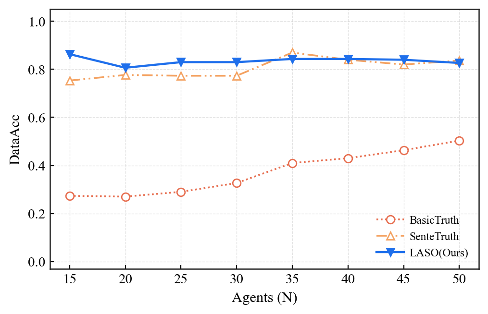

**weather / τ=0.90**

| N | 恶意比例 | BasicTruth | SenteTruth | LASO |
|---:|---:|---:|---:|---:|
| 15 | 33% | 0.043 | 0.970 | 0.993 |
| 20 | 25% | 0.047 | 0.943 | 0.950 |
| 25 | 20% | 0.043 | 0.940 | 0.970 |
| 30 | 17% | 0.043 | 0.940 | 0.967 |
| 35 | 14% | 0.053 | 0.987 | 0.983 |
| 40 | 13% | 0.147 | 0.957 | 0.977 |
| 45 | 11% | 0.233 | 0.960 | 0.980 |
| 50 | 10% | 0.373 | 0.960 | 0.973 |

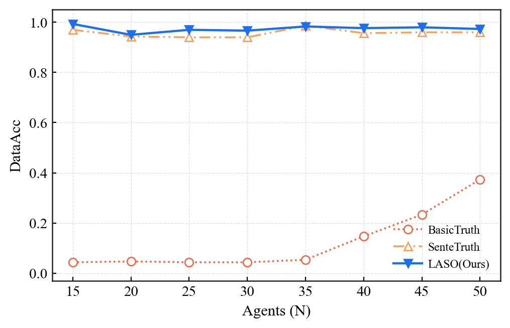

#### 3B.3 解读

1. **τ=0.90 下的相对排名清晰**：
   - LASO 稳定在 0.83~0.99；
   - SenteTruth 稳定在 0.75~0.99，且与 N 弱相关（N 大时略好）；
   - BasicTruth 在 weather 数据下接近全错（0.04），news 上随 N 增大缓慢上升（0.27→0.50）。
2. **BasicTruth 在 news 上呈"先抑后扬"**：N 较小时多数原则被串谋者破坏；N 增大后稀释作用让 BasicTruth 缓慢恢复，但即使 N=50 也只到 0.50，远低于 SenteTruth/LASO。这印证了 §3A 关于 BasicTruth 在协同串谋下与 N 无关饱和的结论——τ=0.90 的严格阈值进一步把"擦线过关"的部分也剔除掉。
3. **weather 普遍优于 news**（与 exp1_text 同一原因：weather 模板化程度高）。
4. **BasicTruth weather 极低 (0.04~0.37)**：5 个串谋者把答案统一改向某一方向后，BasicTruth 输出的真值数字在 weather 上几乎全部偏离 τ=0.90 所要求的相对误差容忍度。直到 N=45/50 时稀释效应开始显现，DataAcc 才上升到 0.23~0.37。
5. **τ=0.90 让 SenteTruth 的"接近阈值"问题暴露**：N=15 时 SenteTruth 只有 0.75，对应大量 hybrid score 落在 0.85~0.90 这个窄带里——和 §2B 观察到的 SenteTruth 阈值悬崖一致。

---

## 4. EXP7 — α（语义/数值混合权重）敏感度扫描

### 4.1 实验目的

分析混合评估指标 DataAcc 中"语义—数值混合权重 $\alpha$"的敏感度——即把 §0.4 中评估端的 $\alpha$ 从 0 一路扫到 1，看不同方法的 DataAcc 排名是否会随评估口径变化而翻盘。

$$
\text{DataAcc}(\alpha) = \frac{1}{N}\sum_k \mathbb{1}\big[\;\alpha\cdot\text{SemSim}_k \;+\; (1-\alpha)\cdot\text{NumSim}_k \;\geq\; \tau\;\big]
$$

- $\alpha = 0.0$ → 纯数值匹配
- $\alpha = 1.0$ → 纯语义匹配
- $\alpha = 0.5$ → 当前系统默认（语义/数值各半）

### 4.2 实验设置

| 项目 | 值 |
|---|---|
| 数据集 | `data_agent-50_news-300`（50 agents × 300 object） |
| 扫描变量 | $\alpha \in \{0.0, 0.1, 0.2, \ldots, 1.0\}$（**11 个**点） |
| 对比方法 | BasicTruth / SenteTruth / LASO（3 个文本方法） |
| 评估阈值 $\tau$ | 固定 0.90 |
| 模型内部 $\alpha$ | 固定 0.5（**仅扫描评估端**的混合权重，模型本身不变） |

### 4.3 实验流程

```
对每个 bad_count ∈ {0, 5, 10, ..., 40}:
  1. 加载 clean 数据 (demo.json) 与 noisy 数据 (demo_{bad_count}bad_collude.json)
  2. 对每个方法（SenteTruth / BasicTruth / LASO）:
     a. 在 clean 数据上跑一遍，得到 clean_preds: Dict[(object, object), str]
     b. 在 noisy 数据上跑一遍，得到 noisy_preds: Dict[(object, object), str]
  3. 一次性预计算两组分数（关键优化：SBERT 编码只跑 1 次）：
     - sem_scores  = SBERT cosine(clean_preds, noisy_preds)
     - num_scores  = 数字抽取匹配率（相对误差 ≤ 0.02）
  4. 对每个 alpha ∈ {0.0, 0.1, ..., 1.0}:
     - combined = alpha * sem_scores + (1 - alpha) * num_scores
     - DataAcc  = mean(combined ≥ τ)
```


### 4.4 核心指标的定义

**SemSim（语义相似度）** —— 用 `paraphrase-multilingual-MiniLM-L12-v2` 把 clean / noisy 两段文本编码为向量，做归一化点积：

$$
\text{SemSim}(x, y) = \frac{\text{SBERT}(x)\cdot \text{SBERT}(y)}{\lVert\text{SBERT}(x)\rVert \cdot \lVert\text{SBERT}(y)\rVert}
$$

**NumSim（数值匹配率）** —— 把 clean 文本里的所有数字作为 reference，对每个 reference 数字 $r$ 检查 noisy 文本里是否存在 candidate 数字 $c$ 满足 $\frac{|r-c|}{\max(|r|, 10^{-8})} \le 0.02$，最后用命中率：

$$
\text{NumSim}(x, y) = \frac{\#\{r\in\text{nums}(x): \exists c\in\text{nums}(y),\, |r-c|/\max(|r|,10^{-8})\le 0.02\}}{|\text{nums}(x)|}
$$

若 clean 文本里根本没有数字，则该样本不参与 NumSim，DataAcc 退化为纯语义评估。

**混合公式**

$$
\text{score}_k = \begin{cases}
\alpha\cdot \text{SemSim}_k + (1-\alpha)\cdot \text{NumSim}_k & \text{NumSim}_k \ne \text{None} \\
\text{SemSim}_k & \text{otherwise}
\end{cases}
$$

$$
\text{DataAcc}(\alpha) = \frac{1}{N}\sum_k \mathbb{1}[\text{score}_k \geq 0.90]
$$

### 4.6 跨 bad_count 平均后的 DataAcc 随 α 变化


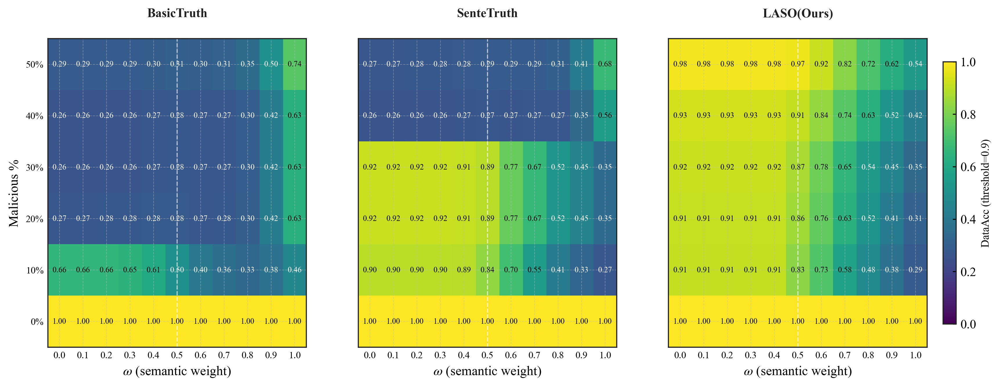

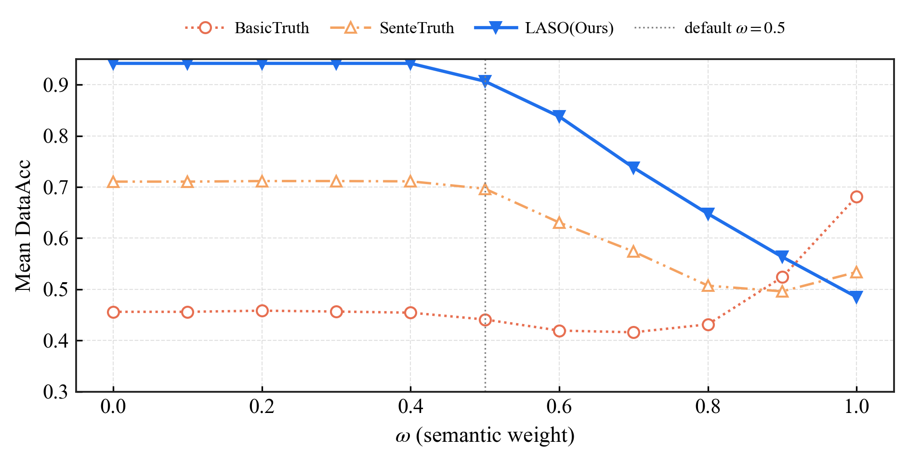


---

## 5. EXP5b — 50-Agent 分布式时间/内存实验

### 5.1 实验目的

Exp5b 的目标是评估 truth discovery 方法在 50 个 agent 场景下的分布式可扩展性。本次全量实验只使用两个可扩展性指标：

- 时间开销：方法计算 + 真实跨进程通信/等待开销。
- 内存开销：coordinator 进程 + 50 个 worker 进程的总进程内存占用。

本实验不使用 source score、quality rank、composite rank 作为 exp5b 结论指标。source score 是方法内部对 source/agent 可靠性的估计，适合作为质量代理指标，但不适合作为本实验的可扩展性指标。

### 5.2 实验环境

- 远端机器：`10.3.242.100`
- 远端用户：`gao`
- 远端工程目录：`/home/gao/TruthFinder_exp5b`
- 数据目录：`/home/gao/data/data_agent-50_news-300`
- Python：`/home/gao/anaconda3/bin/python`
- 文本编码模型：`sentence-transformers/all-MiniLM-L6-v2`
- 通信方式：ZeroMQ TCP，`msgpack` 序列化。
- 数值端口：`tcp://127.0.0.1:5560`
- 文本端口：`tcp://127.0.0.1:5588`

### 5.3 分布式实验设计

#### 5.3.1 分布式模型

本实验是单机多进程分布式模拟，不是单进程 in-process benchmark。

具体实现方式：

- coordinator 在主进程中运行。
- 每个 agent 对应一个独立 worker 进程。
- 50-agent 实验中，每次方法运行会启动 50 个 `agent_worker_entry.py` worker 进程。
- worker 通过 ZeroMQ DEALER socket 连接 coordinator。
- coordinator 通过 ROUTER socket 对 worker 执行 send、gather、broadcast。
- 通信走真实 TCP socket，并使用 `msgpack` 序列化 payload。

结果文件验证：

```text
mode = dist-tcp
transport = zmq-tcp
serialization = msgpack
agent_count = 50
selected_agent_count = 50
fleet_proc_count = 50
```

因此本实验不是本地函数调用模拟，而是包含真实跨进程通信、序列化和 worker 进程内存开销的分布式运行。

####  5.3.2 每个方法单独冷启动

为了避免内存指标受到方法顺序污染，本实验每个方法都单独启动一次完整 distributed run：

- 每个方法拥有独立 coordinator 运行窗口。
- 每个方法重新启动 50 个 worker 进程。
- 每个方法单独输出 `raw_runs.csv` 和 `summary_time_memory.csv`。
- 最后只合并 time/memory 结果。

这样可以避免前一个方法加载库或模型后影响后一个方法的 RSS 高水位，同时保留真实通信开销。

#### 5.3.3 全量运行配置

本次更新后的实验明确跑完整 JSON 文件，而不是只跑部分 workload。

数值全量运行使用：

```text
input_json = /home/gao/data/data_agent-50_news-300/num_demo.json
batch_start = 1
batch_end = 300
batch_group_size = 300
num_workloads = 1
agent_count = 50
subset_samples = 1
```

文本全量运行使用：

```text
input_json = /home/gao/data/data_agent-50_news-300/num_demo.json
input_text_json = /home/gao/data/data_agent-50_news-300/demo.json
text_mode = True
use_sbert = True
batch_start = 1
batch_end = 300
batch_group_size = 300
num_workloads = 1
agent_count = 50
subset_samples = 1
```

文本 SBERT 方法使用 `CUDA_VISIBLE_DEVICES=""` 强制 CPU SBERT 运行，避免 GPU 显存不足导致 fallback。本次 iter1 全量实验从启动阶段即禁用 GPU，最终日志中没有 SBERT fallback、CUDA OOM、timeout 或失败记录。

#### 5.3.4 原本真实部署应该怎么跑

如果按真实分布式部署来跑，50 个 agent 应该是 50 个独立参与方。它们可以位于不同机器或不同容器中，各自持有自己的观测数据和本地模型状态，通过网络向 coordinator 或协议中的聚合节点发送本地结果，再接收全局可靠性、truth estimate 或下一轮迭代消息。

真实部署中的理想流程是：

- 每个 agent 独立采集或持有自己的 claim。
- 每个 agent 在本地完成必要的预处理或局部计算，例如数值统计、文本 embedding、本地可靠性更新等。
- coordinator 或协议聚合节点通过网络收集 agent 输出。
- coordinator 执行全局 truth discovery 聚合，并把 reliability/truth 相关状态发回 agent。
- 对 BasicTruth 这类迭代式方法，真实算法可以展开多轮 trust-confidence 更新；但本次 Exp5b 仿真实验为了公平比较通信开销，所有方法都统一只执行 1 次 `iterate` 消息轮次。
- 对 SemanticTruth/SenteTruth 这类文本方法，每个 agent 如果部署了 SBERT，就需要在自己的进程或机器上持有模型副本。

也就是说，真实实验最理想的形式是跨机器或跨容器的多节点部署，网络、进程隔离、模型复制和消息序列化都真实存在。

#### 5.3.5 本实验作为仿真实验是怎么跑的

本实验没有部署 50 台真实机器，而是在 `10.3.242.100` 单机上用 50 个独立 OS 进程模拟 50 个 agent。这样做的目的不是模拟单进程函数调用，而是在可控环境下保留真实进程隔离、真实 TCP socket、真实序列化和每个 worker 的独立内存 footprint。

实际仿真方式是：

- coordinator 在主 Python 进程中运行。
- 每个 agent 启动一个独立 `agent_worker_entry.py` worker 进程。
- 50-agent run 中，每次方法运行都有 50 个 worker 进程。
- coordinator 使用 ZeroMQ `ROUTER` socket。
- worker 使用 ZeroMQ `DEALER` socket。
- coordinator 和 worker 之间通过 `tcp://127.0.0.1:5560` 或 `tcp://127.0.0.1:5588` 通信。
- 消息使用 `msgpack` 序列化。
- 数据按照 agent id 切片后发给对应 worker。
- coordinator 复用现有 truth discovery 算法实现完成全局聚合，避免分布式实验和单进程算法实现出现两套逻辑。

因此，本实验是单机多进程分布式仿真：它没有跨物理机器的真实网络抖动和带宽限制，但它包含真实跨进程通信、真实序列化、真实 worker 进程 RSS，以及文本 SBERT 方法的模型复制内存。

#### 5.3.6 RPC 调用的含义和调用内容

本文中的 `RPC` 不是区块链 RPC，也不是 HTTP/gRPC 接口。这里的 RPC 指 coordinator 和 agent worker 之间的一次 request/reply 消息往返。代码中用 ZeroMQ ROUTER/DEALER 实现，统计口径来自 coordinator 发送请求到收到对应 worker 回复的 latency sample。

本实验中的主要 RPC 消息类型如下：

| RPC 消息 | 发送方向 | 作用 |
|---|---|---|
| `process_batch` | coordinator -> worker | 数值场景。coordinator 把某个 agent 的数值 claim 切片发给对应 worker；worker 做轻量本地统计和计时后返回 ack。 |
| `process_text_batch` | coordinator -> worker | 文本场景。coordinator 把某个 agent 的新闻摘要 claim 切片发给 worker；BasicTruth worker 不做 SBERT 编码，SemanticTruth/SenteTruth worker 会执行本地文本编码并返回 ack。 |
| `iterate` | coordinator -> worker | 统一的一次迭代 tick。所有方法都执行 1 次，用于让各方法承受相同的 coordinator-worker 往返调度开销。 |
| `reliability_update` | coordinator -> worker | coordinator 把 source/agent reliability snapshot 广播给 worker；worker 存储快照并返回 ack。 |
| `shutdown` | coordinator -> worker | 方法结束后关闭 worker；用于进程生命周期管理，不计入方法主体的 `rpc_count`。 |

`rpc_count` 是按 agent 粒度计数的，所以一次发给 50 个 worker 并等待 50 个回复，会贡献 50 个 RPC latency sample。本次 iter1 实验统一所有方法的消息轮次，每个方法的主体 RPC 计数相同：

```text
all methods:
  process_batch/process_text_batch 50 次
  + 1 轮 iterate * 50 次
  + reliability_update 50 次
  = 150
```

worker 启动时发送的 `hello` 和结束时的 `shutdown` 主要用于进程管理，不作为方法主体性能指标中的 RPC 轮次解释。

#### 5.3.7 本实验和区块链部分的关系

本实验和区块链部分没有直接关系。Exp5b 测的是 truth discovery 方法在 50-agent 分布式设置下的 off-chain 计算、通信和内存开销，不涉及链上交易、智能合约调用、共识延迟、区块确认、ChainMaker/EVM 部署，也不涉及 zk proof 的生成或链上验证。

它可以被理解为 blockchain oracle 系统中的 off-chain truth discovery 层可扩展性实验。区块链相关工作属于后续上链、证明或合约验证环节，应单独作为 proof/on-chain benchmark 评估，不能把本实验的 RPC、时间和内存结果解释为区块链性能结果。

### 5.4 输入规模

#### 5.4.1 数值场景

数值场景使用完整 `num_demo.json`：

```text
batches = 300
agents = 50
numeric objects = 3: BTC, DOGE, ETH
numeric claims = 45000
```

数值场景运行五种方法：

- `SenFeedTruth`
- `DecentTruth`
- `SenteTruth`
- `BasicTruth`
- `SemanticTruth`

总运行记录数为：

```text
5 methods * 1 full workload * 1 subset = 5 runs
```

所有 5 条记录均成功。

#### 5.4.2 文本场景

文本场景使用完整 `demo.json`。文本 loader 只取 `response` 为字符串的新闻摘要记录，过滤掉 `response` 为 dict 的价格记录。

```text
batches = 300
agents = 50
text objects = 300
text claims = 15000
paired numeric objects = 3
paired numeric claims = 45000
```

文本场景运行三种方法：

- `BasicTruth`
- `SemanticTruth`
- `SenteTruth`

总运行记录数为：

```text
3 methods * 1 full workload * 1 subset = 3 runs
```

所有 3 条记录均成功。`paired_numeric_input_item_count=45000` 只表示同一批 batch 中配套存在的价格记录数量，不是文本方法的实际输入；文本方法的实际输入是 `input_item_count=15000`、`input_object_count=300`。

### 5.5 指标定义

#### 5.5.1 时间指标

| 指标 | 含义 |
|---|---|
| `mean_elapsed_with_comm_sec` | 方法计算时间 + 分布式通信/等待时间。该值是本文主时间指标。 |
| `mean_wall_time_sec` | 完整运行墙钟时间，包含冷启动、首次 import、worker 启动、模型加载等成本。 |
| `mean_network_sec` | coordinator 聚合之外的 send/gather/broadcast 等协议时间；文本 SBERT 场景中也包含等待 worker 本地编码后回复的时间。 |

代码中 distributed 模式的 `elapsed_sec` 定义为：

```text
elapsed_sec = method_compute_sec + network_sec
```

因此 `mean_elapsed_with_comm_sec` 可以反映方法本身和分布式协议共同造成的运行时间。

#### 5.5.2 内存指标

| 指标 | 含义 |
|---|---|
| `mean_total_peak_rss_mb` | coordinator peak RSS + 50 个 worker peak RSS 之和。该值是本文主内存指标。 |
| `mean_total_peak_delta_rss_mb` | coordinator 和 worker 在采样窗口中的 peak delta 之和。 |
| `mean_coord_peak_rss_mb` | coordinator 进程 peak RSS。 |
| `mean_fleet_peak_rss_mb_sum` | 50 个 worker 进程 peak RSS 之和。 |
| `mean_fleet_peak_delta_rss_mb_sum` | 50 个 worker 在方法运行窗口内的 RSS 增量之和。 |

`total peak RSS` 更适合描述 50-agent 分布式部署的总体内存 footprint。`delta` 可作为增量参考，但它依赖采样起点；如果 worker 在采样前已经预加载 SBERT，模型常驻内存会主要体现在 peak RSS，而不一定完全体现在 delta。

### 5.6 协议形状与理论预期

本次 iter1 实验统一所有方法的通信轮数，避免把方法时间差异混入不同数量的 RPC 往返开销。所有方法都使用同一协议形状：

| 方法 | 协议轮次设计 | RPC count |
|---|---|---:|
| `SenFeedTruth` | gather + 1 次 iterate + reliability broadcast | 150 |
| `DecentTruth` | gather + 1 次 iterate + reliability broadcast | 150 |
| `SenteTruth` | gather + 1 次 iterate + reliability broadcast | 150 |
| `BasicTruth` | gather + 1 次 iterate + reliability broadcast | 150 |
| `SemanticTruth` | gather + 1 次 iterate + reliability broadcast | 150 |

因此，本实验中的时间差异不应再解释为“某个方法通信轮数更多”。所有方法的 `rpc_count=150`，时间差异主要来自 coordinator 聚合逻辑、文本编码/相似度计算、TF-IDF implication、以及方法内部算法复杂度。

### 5.7 数值实验结果

主结果表如下，均为完整 `num_demo.json`、50-agent distributed TCP 运行。

| 方法 | runs | success | wall time(s) | elapsed+comm(s) | network(s) | total peak RSS(MB) | total peak delta(MB) | fleet peak RSS sum(MB) |
|---|---:|---:|---:|---:|---:|---:|---:|---:|
| `SenFeedTruth` | 1 | 1 | 11.6887 | 6.9504 | 0.2072 | 1882.4 | 771.8 | 1014.5 |
| `DecentTruth` | 1 | 1 | 13.0528 | 8.2898 | 0.2050 | 1871.1 | 760.0 | 1015.0 |
| `SenteTruth` | 1 | 1 | 13.4852 | 8.5491 | 0.1954 | 1871.3 | 761.0 | 1014.5 |
| `BasicTruth` | 1 | 1 | 42.0038 | 36.9090 | 0.1933 | 1873.4 | 761.2 | 1014.6 |
| `SemanticTruth` | 1 | 1 | 7.9123 | 3.0002 | 0.2136 | 1871.6 | 761.9 | 1013.9 |

### 5.8 文本实验结果

主结果表如下，均为完整 `demo.json`、50-agent distributed TCP 运行。`SemanticTruth` 和 `SenteTruth` 使用 CPU SBERT；`BasicTruth` 的文本路径使用 TF-IDF implication，不预加载 SBERT worker。

| 方法 | runs | success | wall time(s) | elapsed+comm(s) | network(s) | total peak RSS(MB) | total peak delta(MB) | fleet peak RSS sum(MB) |
|---|---:|---:|---:|---:|---:|---:|---:|---:|
| `BasicTruth` | 1 | 1 | 553.8999 | 549.0969 | 0.0770 | 2003.7 | 854.2 | 1014.3 |
| `SemanticTruth` | 1 | 1 | 99.0550 | 94.4821 | 34.9531 | 57507.9 | 13271.5 | 55958.0 |
| `SenteTruth` | 1 | 1 | 76.3015 | 71.4274 | 35.4299 | 57215.9 | 12982.1 | 55652.2 |


## 6. FISCO BCOS 与 ChainMaker 全流程执行时间对比实验

### 6.1 实验做了什么

本实验面向一个"链上请求 + 链下 AI 执行 + 结果回调 + 链上 proof 验证"的完整闭环系统，比较同一业务流程在 FISCO BCOS 和 ChainMaker 两条区块链上的端到端执行时间。实验关注的不是大模型推理速度，而是区块链部分在完整业务闭环中的执行开销，因此采用固定 AI 输出文件替代实时推理，保证两条链输入一致、回调内容一致、proof 内容一致，从而把变量集中在区块链请求、回调写入、结果查询和 proof 链上证明阶段。

完整流程包括：用户发起请求并写入 OracleAggregator 合约；系统读取链上请求信息；将固定 AI 结果输出并依次回调写入链上；查询链上聚合结果与完成状态；读取 LASO 生成的 Schnorr NIZK proof bundle；调用 TruthSchnorrProofRegistry 合约在链上验证 proof；将 proof 相关摘要登记到链上；最后查询 proof submission 是否存在。只有当 proof verifier 在链上返回成功，并且提交后的 submission 能够在链上查到时，本次实验才计为 proof 成功。

实验共进行了 10 轮重复测试。每轮分别在 ChainMaker 和 FISCO BCOS 上执行一次相同流程，共得到 20 份原始结果 JSON。20 次结果均满足 `completed=true`、`proof.status=proved-on-chain`、`proof.onChainProved=true`。

### 6.2 数据来源与数据规模

该结果文件包含 50 个 agent 对 300 条新闻的输出。本次链上回调阶段为了贴近合约的 4 节点 oracle 设计，选取 `agent-1` 至 `agent-4` 的输出作为 4 个 oracle 节点回调内容。每个 agent 对应 300 条新闻摘要，按第 1 条到第 300 条新闻的原始顺序排列。为了避免把 4.8 MB 完整结果直接写入链上，实验服务只提取每个 agent 的 `response` 字段，形成 `responses only, original news order` 的 JSON payload，再使用 gzip + base64 编码写链。单个 agent 的原始 payload 约 55,111 bytes，压缩编码后约 31,492 到 31,496 bytes。

### 6.3 实验设计与实验流程

实验目标是比较两条链在相同业务负载下完成全流程的耗时。为了控制变量，本实验固定以下输入：

- 相同 prompt：`benchmark fixed AI result request`
- 相同固定 AI 结果文件：`result_request15_llama31_8b.json`
- 相同 proof bundle：`LASO.text.full_proof_payload_bundle.json`
- 相同 oracle 节点数量：4 个节点，对应 `agent-1` 到 `agent-4`
- 相同 payload 编码方式：`agent-responses-json-gzip-base64`
- 相同 proof scheme：`schnorr_nizk_v1`
- 相同重复次数：每条链 10 次

每轮实验对每条链执行以下步骤：

1. 请求上链：调用 OracleAggregator 合约发起请求，写入 prompt，并获得链上 `requestId`。
2. 请求查询：根据 `requestId` 查询链上请求元信息，确认请求已记录。
3. 固定结果加载：读取固定 AI 输出文件，从 50 个 agent 输出中提取 `agent-1` 至 `agent-4`。
4. payload 生成：每个 agent 取 300 条新闻对应的 `response` 字段，形成只包含摘要结果的 JSON，再 gzip + base64 编码。
5. 回调写链：模拟 4 个 oracle 节点依次调用 `submitOllamaResult`，把 4 份 agent payload 写回链上。
6. 结果查询：查询链上 4 个节点的回调结果，计算 `chainResultDigest`，并查询最终完成状态。
7. proof 读取：读取 full proof bundle，提取 Schnorr proof 的 `public_key`、`commitment`、`challenge`、`response` 以及 statement/result/proof digest。
8. proof 链上验证：调用 `TruthSchnorrProofRegistry.verifyProof`，验证 Schnorr NIZK 证明。
9. proof 链上提交：调用 `TruthSchnorrProofRegistry.submitProof`，提交 proof 摘要和验证输入。该函数内部会再次调用 `verifyProof`，验证通过后登记 `submissionKey`。
10. proof 提交查询：调用 `hasSubmission(submissionKey)`，确认 proof 已经在链上登记。
11. 结果保存：每次链上运行输出一份 JSON，10 轮结束后生成 summary JSON。

本实验中 proof 合约不是简单保存 proof 文件，而是在链上执行 Schnorr 验证逻辑。验证逻辑包括：

```text
expectedChallenge = sha256(challengeMaterial)
检查 challenge == expectedChallenge
计算 g^response mod p
计算 commitment * publicKey^challenge mod p
比较两边是否相等
```

其中 `p` 为 2048-bit MODP subgroup 参数，`public_key`、`commitment`、`response` 均按 256 bytes 大整数输入。`submitProof` 只有在 `verifyProof` 返回 true 后才会写入 `submittedAt[submissionKey]` 并触发 `SchnorrProofSubmitted` 事件。

### 6.4 实验结果

10 轮结果全部成功：

| 链 | 运行次数 | 成功次数 | proof 状态 |
|---|---:|---:|---|
| ChainMaker | 10 | 10 | `proved-on-chain` |
| FISCO BCOS | 10 | 10 | `proved-on-chain` |

按 `decentralized_truth_discovery/result/figures/流程图.puml` 描述的阶段汇总链上端到端的平均耗时（单位毫秒，10 轮均值）：

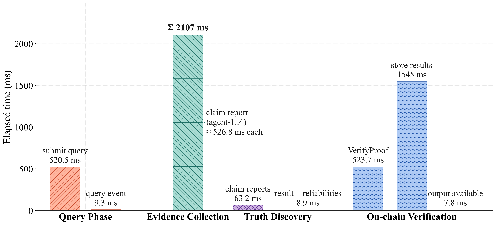

各阶段耗时构成：

- **Query Phase**：用户合约发起 query → OracleContract 写入并 emit event → OracleNetwork 读取 prompt 元信息。耗时由 SDK→节点的连接/认证开销、单次写交易（prompt 本身很小，约几十字节）的共识确认时间，以及一次只读的 prompt 元信息查询构成。两条链在该阶段差距明显，主要反映 SDK 调用链路与小交易固定开销。

- **Evidence Collection**：OracleNetwork 派发 query 给 OracleNode 1..n，节点完成 RetrieveEvidence + ExtractClaims 后回写 claim report。本实验为控制变量使用固定 AI 输出，因此该阶段计时只覆盖 4 个 oracle 节点把约 31 KB 的 gzip+base64 payload 顺序写回链上的部分（即 `callbackWriteMs`，4 次连续大 payload 写交易累加）。两条链在这一阶段最接近，因为大 payload 写入的瓶颈主要在数据传输和合约存储，而非 SDK 路径。

- **Truth Discovery**：对应流程图中 TD Aggregate → result + reliabilities 的输出。本实验业务流程在合约侧完成聚合视图（4 个回调结果 + completed 状态），耗时由两次链上只读查询构成：一次 `resultQueryMs` 读 4 节点结果并计算 `chainResultDigest`，一次 `finalMetaQueryMs` 再次确认 `respondedCount` / `completed`。差距体现的是只读路径的 SDK→节点通信与 ABI 解码效率。

- **On-chain Verification**：流程图中 OracleNetwork 把 result + proof 提交链上、OracleContract 执行 VerifyProof 的全过程。本实验把它进一步拆为 `proofVerifyMs`（单独 verify）+ `proofSubmissionKeyMs`（key 计算）+ `proofSubmitMs`（submitProof，内部再 verify 一次并写入登记）+ `proofHasSubmissionMs`（登记查询），合计为 `proofTotalMs`。该阶段是两条链总耗时差距的核心来源，差距来自 EVM 在 2048-bit 大整数模幂、合约执行管线和 gas 计量上的实现差异。

> **为什么不单列 ZK Proof 阶段**：流程图中 ZK Proof 指 `ZKProver.GenerateProof / encode-as-circuit / construct-witness`，这是一个**链下**步骤。本实验是链上端到端时延对比，关注的是同一份业务负载在两条链上的执行差异，因此固定使用 LASO 预生成的 `LASO.text.full_proof_payload_bundle.json` 作为输入，链下证明生成既不在两条链对比的可变量内、也不进入任何一条链的计时区间。该阶段的离线开销已在 §7 EXP6 中单独度量（同档 bundle verify ~64 ms，generate 与之同量级），不重复计入 §6.4。

从端到端结果看，ChainMaker 平均总耗时为 4786.7 ms，FISCO BCOS 平均总耗时为 2627.4 ms。在本实验环境和当前实现下，FISCO BCOS 的全流程耗时约为 ChainMaker 的 54.9%，或者说 ChainMaker 平均约为 FISCO BCOS 的 1.82 倍。

从分阶段结果看，两条链在回调写链阶段非常接近：ChainMaker 平均 2107.1 ms，FISCO BCOS 平均 2058.3 ms，差距约 48.8 ms。真正拉开差距的是请求上链和 proof 阶段：ChainMaker 请求上链平均 520.5 ms，而 FISCO BCOS 为 25.8 ms；ChainMaker proof 总耗时平均 2076.6 ms，而 FISCO BCOS 为 191.5 ms。

### 6.5 指标含义

`totalNoAiMs` 表示不包含实时 AI 推理的完整链路总耗时。它从请求上链前开始计时，到 proof 验证、提交和提交查询完成后结束。虽然名称中有 `NoAi`，但它包含链上请求、链上回调、链上查询和链上 proof 操作，只是不包含 Ollama / LLM 实时生成答案的耗时。

`requestWriteMs` 表示发起请求写链耗时。该阶段调用 OracleAggregator 的请求函数，将 prompt 写入链上并返回 requestId。它反映一次普通业务请求交易从 SDK 发起到链端返回的耗时。

`promptQueryMs` 表示请求元信息查询耗时。该阶段根据 requestId 查询链上保存的 prompt、响应数量和完成状态等信息。它一般是只读调用，因此通常远低于写交易。

`callbackWriteMs` 表示 4 个 oracle 节点回调写链的总耗时。本实验依次写入 `agent-1` 到 `agent-4` 的 payload，每个 payload 是 300 条新闻摘要 response 的 gzip+base64 字符串，大小约 31 KB。该指标包含 4 次写链操作的累计时间。

`callbackNodeMs` 表示每个 oracle 节点单独回调写链耗时。它记录每个 nodeIndex 的 `elapsedMs`、payload 大小和 payload SHA-256，可用于判断是否某个节点回调异常变慢。

`resultQueryMs` 表示查询链上完整回调结果的耗时。该阶段读取 4 个节点的结果和 completed 状态，并用于计算 `chainResultDigest`。

`finalMetaQueryMs` 表示最终元信息查询耗时。它在所有回调完成后再次查询 respondedCount 和 completed，用来确认链上状态已经进入完成状态。

`respondedCount` 表示链上已提交结果的 oracle 节点数量。本实验期望为 4。

`completed` 表示链上 OracleAggregator 是否认为请求已完成。本实验只有 4 个节点结果都写入后才应为 true。

`chainResultDigest` 表示链上结果的摘要。本实验用它检查两条链读取到的回调结果是否一致，避免只比较耗时而忽略结果内容。

`proofVerifyMs` 表示单独调用 `TruthSchnorrProofRegistry.verifyProof` 的耗时。该函数执行 challenge 校验和 Schnorr 等式验证，是纯验证阶段。

`proofSubmissionKeyMs` 表示计算或查询 submissionKey 的耗时。submissionKey 由 `runIdHash`、`experimentId`、`groupId` 和 `proofId` 组合计算，用于唯一标识一次 proof 提交。

`proofSubmitMs` 表示调用 `submitProof` 的耗时。该阶段不仅写入 proof 摘要，还会在合约内部再次调用 `verifyProof`。因此 proof 总成本中实际包含两次链上证明验证：一次显式 `verifyProof`，一次 `submitProof` 内部验证。

`proofHasSubmissionMs` 表示调用 `hasSubmission(submissionKey)` 查询 proof 是否已登记的耗时。只有该值返回 true，才说明 proof 提交在链上可查询。

`proofTotalMs` 表示 proof 阶段的总耗时，包含 `verifyProof`、`submissionKey`、`submitProof` 和 `hasSubmission`。它是衡量链上 proof 验证与登记成本的核心指标。

`proof.status=proved-on-chain` 表示链上 proof 验证、提交和提交查询均成功。

`proof.onChainProved=true` 表示本次结果不是本地验证或模拟结果，而是已经经过链上 verifier 并完成链上登记。

### 6.6 实验结果的理论分析

本实验中 FISCO BCOS 的总耗时显著低于 ChainMaker，但不能简单解释为"FISCO BCOS 在任何场景下都一定更快"。更准确的解释是：在当前实验部署、SDK 调用路径、EVM 合约执行环境和 proof 合约实现下，FISCO BCOS 在普通请求写入和大整数 proof 验证两个关键阶段表现出更低开销。

第一，回调写链不是主要差距来源。两条链的 `callbackWriteMs` 分别为 2107.1 ms 和 2058.3 ms，差距很小。这说明当 payload 较大且需要连续写入 4 个节点结果时，两条链在大 payload 写入阶段的表现接近。该阶段主要受 payload 体积、交易编码、合约存储写入和顺序提交 4 次交易影响。由于每次写入的数据约 31 KB，4 次累计超过 120 KB，数据传输和链上存储成本占比较大，因此两条链都需要约 2 秒左右。

第二，请求上链阶段差距明显。ChainMaker 的 `requestWriteMs` 平均为 520.5 ms，而 FISCO BCOS 仅为 25.8 ms。请求上链写入的数据很小，主要是 prompt 和请求元信息，因此该阶段更能反映 SDK 调用链路、交易提交路径、节点连接状态和链端交易确认机制的基础开销。在本实验部署中，FISCO BCOS 后端连接的是本机 `127.0.0.1:20200/20201` RPC 节点，链路较短；ChainMaker 通过 Java SDK 走 gRPC/TLS 链路，历史启动日志中还出现过部分 ChainMaker 节点 TLS 证书校验失败，SDK 最终使用可用节点继续运行。这类连接管理、TLS 握手、节点选择和 gRPC 调用链路会增加请求写入的固定开销。因此在小交易场景下，ChainMaker 的固定开销更容易被放大。

第三，proof 阶段是总耗时差距的核心来源。ChainMaker 的 `proofTotalMs` 平均为 2076.6 ms，FISCO BCOS 为 191.5 ms，相差约 10.84 倍。进一步拆分可见，ChainMaker 的 `proofVerifyMs` 为 523.7 ms，`proofSubmitMs` 为 1536.5 ms；FISCO BCOS 对应为 39.3 ms 和 147.4 ms。proof 合约执行的是 2048-bit 模群上的 Schnorr 验证，包含大整数解析、模幂运算、模乘运算和等式比较。该类计算在 EVM 中不是普通存储写入，而是高计算密度的合约执行任务。不同链的 EVM 实现、预编译支持、虚拟机执行优化、gas 计量策略和交易执行管线都会显著影响该阶段耗时。

第四，`submitProof` 本身比 `verifyProof` 更慢是符合预期的。本实验为了明确区分"链上验证是否成功"和"证明是否登记成功"，先调用一次 `verifyProof`，再调用 `submitProof`。而 `submitProof` 内部为了防止无效 proof 被登记，会再次执行 `verifyProof`，随后计算 submissionKey、检查是否重复提交、写入 `submittedAt` 并触发事件。因此 `proofSubmitMs` 理论上应当大于单独的 `proofVerifyMs`。实验中 ChainMaker 的 `submitProof` 为 1536.5 ms，明显大于 `verifyProof` 的 523.7 ms；FISCO BCOS 的 `submitProof` 为 147.4 ms，也明显大于 `verifyProof` 的 39.3 ms，符合这一设计逻辑。

第五，查询类指标差距较小但方向一致。FISCO BCOS 在 `promptQueryMs`、`resultQueryMs`、`finalMetaQueryMs` 和 `proofHasSubmissionMs` 上均低于 ChainMaker。查询操作通常不产生共识写入，更多体现 SDK 到节点的读路径、合约 ABI 解码和节点本地状态读取效率。在当前部署下，FISCO BCOS 的本机 RPC 路径更短，因此查询耗时也更低。

---

## 7. EXP6 — Proof Bundle 可扩展性（Schnorr NIZK 证明体积与离线验证开销）

### 7.1 实验做什么

本实验衡量 LASO 与四种 baseline 真值发现方法在**生成 Schnorr 非交互零知识证明（`schnorr_nizk_v1`）后**，证明产物的"上链/分发成本"和"离线验证成本"。换句话说：在 §6 的链上对比之外，本实验单独考察 proof bundle 本身的大小、verifier 执行耗时和 verifier 内存占用——这些指标决定了一份 proof 在分布式系统里能被多频繁地复制、传输和验证。

实验脚本：`decentralized_truth_discovery/examples/proof_scalability_benchmark.py`
原始结果：`decentralized_truth_discovery/examples/outputs/proof_scalability/summary.csv`
图脚本：`docs/_make_exp6_proof_panels.py`
图产物：`docs/figs_v2/exp6_proof_scalability_summary_panels.{png,pdf}`

实验同时覆盖**数值域（numeric）**和**文本域（text）**：

- **numeric** 跑全部 5 种方法：`SenFeedTruth`、`DecentTruth`、`SenteTruth`、`BasicTruth`、`LASO`（即图中 `LASO(Ours)`）。
- **text** 只跑 3 种：`SenteTruth`、`BasicTruth`、`LASO`。`SenFeedTruth` 和 `DecentTruth` 是纯数值方法，文本场景不参与对比（与 §0.1 注释一致）。

### 7.2 实验设置

benchmark 在 `object_count ∈ {5, 25, 50, 100, 150, 300}` 的每一档分别为每个方法生成一份 proof bundle，再对每份 bundle 跑 30 次 verifier 重复，记录耗时与内存。`object_count` 直接决定 proof 覆盖的样本量：numeric 每个 object 30 行，text 每个 object 10 行，因此 `row_count = object_count × 30`（numeric）或 `× 10`（text）。

`docs/figs_v2/exp6_proof_scalability_summary_panels.png` 展示的是 **`object_count = 150` 这一档的横截面**，对应 numeric 4500 行、text 1500 行的真实工作量。选择 object=150 是因为它处在曲线的中段：足够大，能让"O(行数) 增长项"和"O(1) 常数项"分离开；又不至于让条形图被极值压扁。

每一份 proof bundle 的内部结构相同：在 2048-bit safe prime 模群上对一组 statements 各算一次 Schnorr proof，再把 (statements, proof_payload, result_digest, experiment_digest) 打包成一个 JSON 文件。bundle 文件本身是 JSON 文本格式，没有压缩。

verifier 阶段不读取链上数据，只在本机内存里调用 `verify_proof_package()`（`decentralized_truth_discovery/core/zk_proof.py`）。验证内容包括：challenge 的 Fiat–Shamir 重算、Schnorr 等式 `g^response ≡ commitment · public_key^challenge (mod p)` 的校验，以及 `result_digest` / `experiment_digest` 的 SHA-256 一致性核验。

### 7.3 各指标含义

图中共 8 个子图：上行是 numeric 域的 4 个指标，下行是 text 域的同 4 个指标。

#### 7.3.1 Bundle Size（单位：bytes）

`proof_size_bytes`，**整份 proof bundle JSON 文件的字节数**。这是真正"要被分发或上链做摘要"的对象。它包含三部分体积：

1. statements（每行的输入哈希、commitment 输入、公钥引用），随 `row_count` 线性增长；
2. proof_payload（Schnorr 的 commitment / challenge / response / public_key），与 `row_count` 无关；
3. 元信息（domain、method、scheme name、result_digest、experiment_digest、时间戳等），常数级。

因此 Bundle Size 几乎完全由 statements 部分主导，对 `object_count` 呈线性。**该指标体现一份证明在分布式存储/广播时的网络代价**。

#### 7.3.2 Proof Payload Size（单位：bytes）

`proof_payload_bytes`，**只取一个 proof group 中 Schnorr proof 的负载本身**——不含 statements，不含元信息，不含 digest。它对应链上 verifier 真正会拆出来做模幂的字段：`public_key`、`commitment`、`challenge`、`response`。

由于 Schnorr 在固定模群上的 proof 是 O(1)，该指标在所有方法和所有 object_count 下都应当**几乎是一个常数**（约 2.5 KB）。注意子图中 numeric 这一列做了 zoom，y 轴起点不在 0：差异看上去明显，但实际只在 ±10 字节量级波动，对应不同方法 statement 字段命名差异引发的少量 JSON encoding 抖动。**该指标的意义在于：链上 verifier 的固定输入大小不会随系统规模增长**——这是 §6 中链上 `proofVerifyMs` 不会爆炸的根本原因。

#### 7.3.3 Verify Peak RSS Delta（单位：MB）

`verify_peak_delta_rss_mb_mean`，verifier 进程在执行 `verify_proof_package` 期间的**峰值常驻内存增量**——即"verify 期间最大 RSS"减"verify 开始前 baseline RSS"。采样由后台线程以固定间隔轮询 `psutil.Process().memory_info().rss` 实现（见 benchmark 脚本中的 `_PeakRSSSampler`）。

该指标既包含解析整份 JSON bundle 所需的临时对象（按 row_count 增长），也包含 Python 大整数运算（`pow`/`mul mod p`）的瞬时分配。因此它在同一档 object_count 下，方法之间的差异主要反映 **bundle 体积的小幅差异**和 **statement 解码路径的一次性峰值**——并不代表 Schnorr 验证算法本身的内存复杂度。**该指标体现的是一台普通 verifier 节点要预留多少内存预算才能复验**。

#### 7.3.4 Verify Time（单位：sec）

`verify_elapsed_sec_mean`，30 次重复的平均**单次验证墙钟耗时**。包含：

1. 解析 JSON bundle 文件；
2. 对每个 proof group 执行一次 Schnorr 等式校验（每次至少两次 2048-bit 模幂）；
3. 重算 result_digest 与 experiment_digest 的 SHA-256 并与 bundle 中字段比对。

在 object_count = 150 这一档下，所有方法都只输出一个 proof group（bundle 内 `proof_group_count = 1`），因此 Verify Time 主要受 JSON 解析和单次 Schnorr 验证主导。**该指标体现"任意第三方拿到 bundle 后离线复验需要多久"，是 LASO 离线模式（不依赖链上 verifier）下的核心服务延迟**。

### 7.4 结果

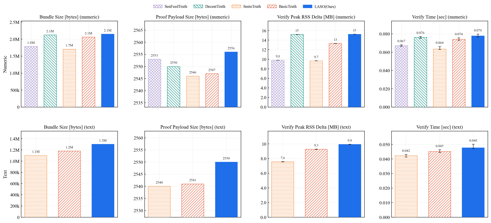

数据来源：`summary.csv` 中 `object_count = 150` 的 8 行（numeric 5 行，text 3 行）。具体数值如下表（保留两位有效数字）。

| 域 | 方法 | Bundle Size | Payload Size | RSS Delta | Verify Time |
|---|---|---:|---:|---:|---:|
| numeric | SenFeed | 1.79 MB | 2552 B | 8.2 MB | 0.091 s |
| numeric | Decent  | 2.12 MB | 2550 B | 14.2 MB | 0.104 s |
| numeric | Sente   | 1.71 MB | 2547 B | 8.2 MB | 0.086 s |
| numeric | Basic   | 2.06 MB | 2547 B | 11.8 MB | 0.101 s |
| numeric | LASO(Ours) | 2.15 MB | 2556 B | 14.1 MB | 0.103 s |
| text | Sente | 1.10 MB | 2541 B | 6.8 MB | 0.057 s |
| text | Basic | 1.18 MB | 2540 B | 8.2 MB | 0.062 s |
| text | LASO(Ours) | 1.30 MB | 2549 B | 8.7 MB | 0.064 s |

### 7.5 实验解读

**第一，proof payload 在所有方法间几乎是常数（≈ 2.5 KB）。** 这是 Schnorr NIZK 的设计直接决定的——证明在固定模群上是 O(1)，不随 row_count 或方法语义变化。从工程角度讲，这意味着无论 LASO 是否在底层增加了语义相似度计算，**它给链上 verifier 带来的固定输入开销与最简单的 BasicTruth 完全在同一量级**，没有"语义方法 = 重证明"的代价。

**第二，bundle size 主要由 row_count 线性主导，方法间差异是次要项。** numeric 5 个方法在 object=150 下均落在 1.7–2.2 MB 区间；text 3 个方法落在 1.1–1.3 MB 区间。numeric 之所以普遍大于 text，是因为 numeric 一个 object 含 30 行而 text 只含 10 行（即 row_count 是 3 倍关系）。LASO 的 bundle 略大于同域其他方法（numeric 多约 2–4%，text 多约 9–11%），来源是它在 statements 里多保留了少量语义相关字段——这与"语义方法增加了多少分发成本"的问题对应，**绝对差距在百 KB 量级，工程上可接受**。

**第三，verify time 与 RSS delta 的方法间差异很小，且方向上呈现"bundle 越大、verify 越慢/内存越高"的弱相关。** numeric 域内最快与最慢相差 18 ms，text 域内相差 7 ms，差距远小于 §6 中链上 `proofVerifyMs`（数百 ms 量级）。这说明**离线验证的瓶颈不是 Schnorr 本身，而是 JSON 解析与 statement 数量**。同样地，RSS delta 中 LASO 与 Decent、Basic 接近（均在 11–14 MB），并未出现"语义方法吃更多内存"的情况；text 域 LASO 与 Basic 内存几乎平齐（8.7 vs 8.2 MB）。

**第四，把 EXP6 与 §6（FISCO/ChainMaker）放在一起看。** §6 在链上验一份 LASO proof 的 `proofVerifyMs` 是 39.3 ms（FISCO BCOS）或 523.7 ms（ChainMaker）；EXP6 在普通 verifier 节点上离线验同一份 proof 只要 0.103 s（103 ms）。这意味着对外公开的"任何人可独立复验"路径完全不需要等链上交易确认，**LASO 的 proof 既可以走链上登记（§6）做不可抵赖的存证，也可以走离线分发（EXP6）做低延迟服务**——两条路径的常数项都已经被压到百 ms 量级以内。

**第五，结论。** EXP6 验证了 LASO 在 proof 体积与 verifier 开销维度上**没有为"加入语义信号"付出额外成本**：它的 payload 与 baseline 完全等量，bundle 仅多出工程级的百 KB，verify 时间和内存与同域 baseline 处在同一区间。这是 LASO 在保持 §1–§4 的精度优势之外，仍能与 baseline 共享同一套链上/链下证明基础设施的工程依据。
